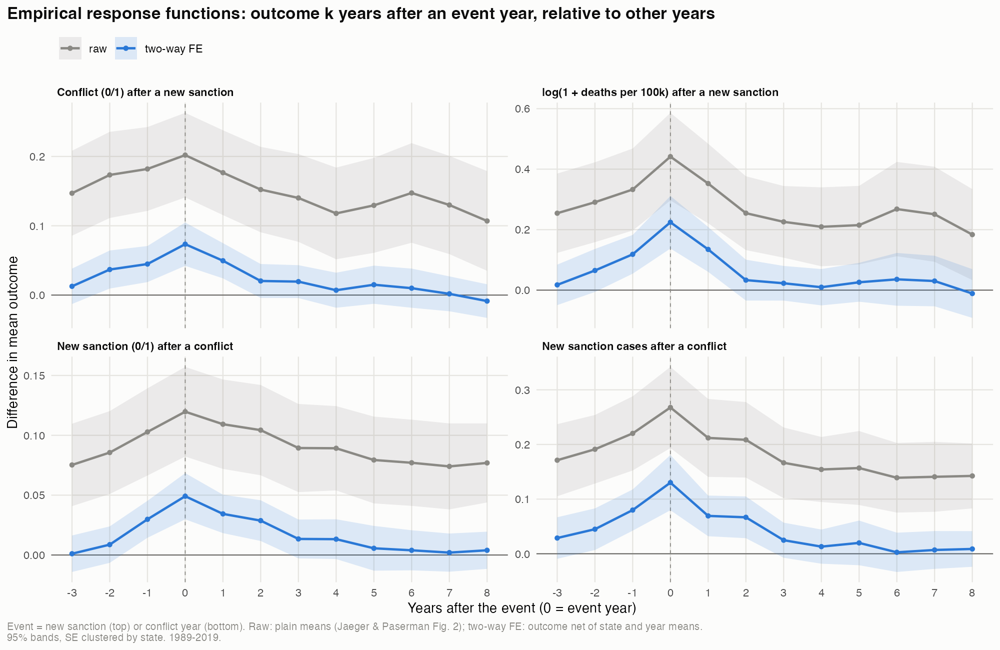
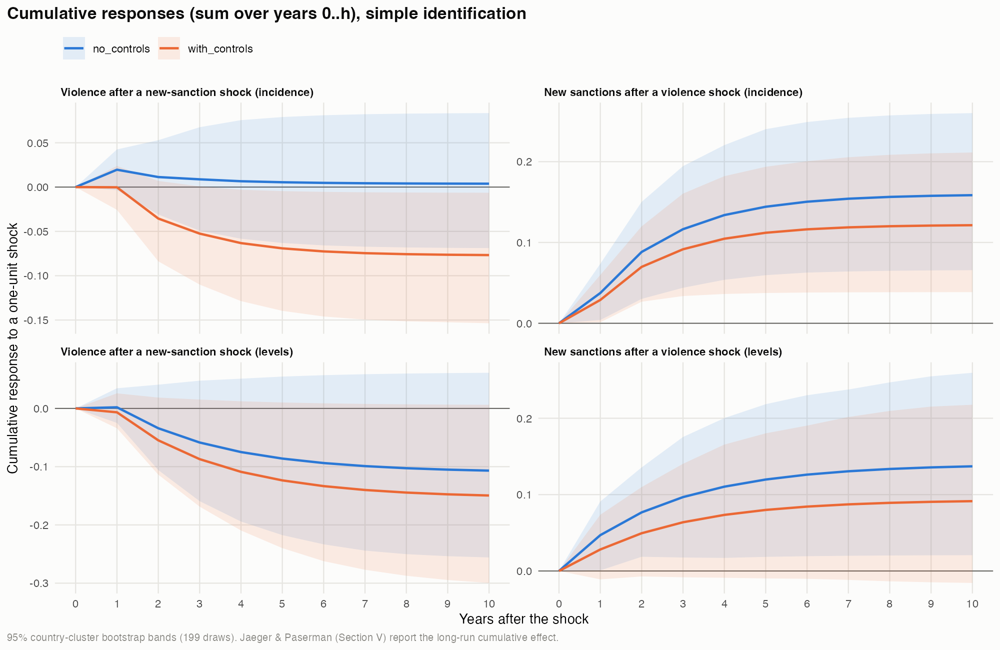
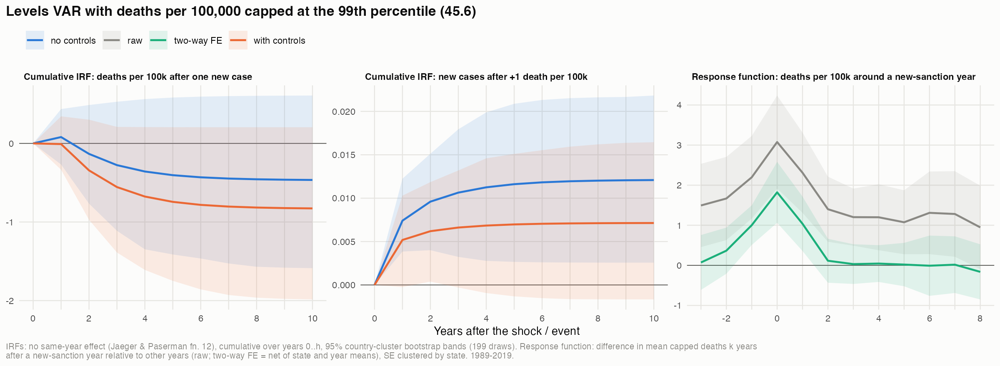
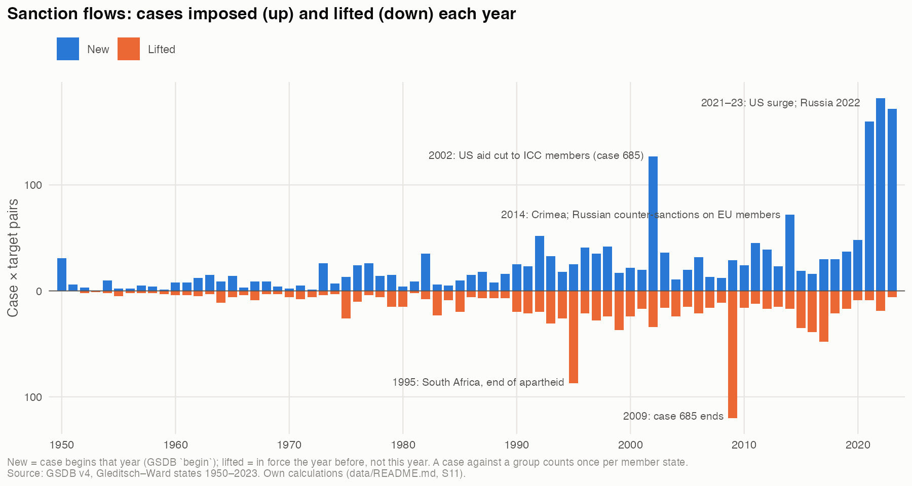

# Sanctions and Violence

**Do economic sanctions reduce or fuel organized violence, and does violence trigger sanctions?**


---

## About the project

Sanctions are one of the international community's main non-military responses to armed conflict. Whether they
calm violence (deterrence, incapacitation) or escalate it (retaliation, resource substitution) is still an open
empirical question, and so is the reverse direction: do senders react to violence in a regular, predictable way?

Following the reaction-function approach of Jaeger & Paserman (2008, *AER*), the project estimates a
**panel VAR on a country-year panel** of sanctions and organized violence and tests Granger causality in both
directions:

| Reaction function | Question |
|---|---|
| **Senders** | Does violence in a country predict new sanctions against it? |
| **Violence** | Do new sanctions predict more or less violence afterwards? |

The specification (sanction measure, violence measure, lags, controls, robustness) is laid out in the analysis plan
[`empirics/ANALYSIS_PLAN.md`](empirics/ANALYSIS_PLAN.md); every later change is logged there.

## Main results (preliminary)

*Status 23 October 2026; numbers from the master run of that date. Full write-up: the advisor brief
[`Writing/main.pdf`](Writing/main.pdf); interpretation per script: [`empirics/notes/`](empirics/notes/README.md);
exact equations and code: [`empirics/notes/model_equations.md`](empirics/notes/model_equations.md).*

Bivariate panel VAR(2) of **new GSDB sanction cases** and **UCDP organized violence**, state and year fixed effects,
197 Gleditsch–Ward states, 1991–2019 (5,538 state-years; 174 states / 4,913 state-years with controls). Two
specifications: *incidence* (new sanction 0/1, conflict year ≥ 25 deaths 0/1) and *levels* (number of new cases,
log(1 + deaths per 100,000)).

1. **Senders react to violence.** Past violence predicts new sanctions (Granger p = 0.007 incidence, 0.026 levels,
   fixed effects only); a conflict year raises the number of new-sanction years over the next decade by 0.09–0.16
   (11 of 12 impulse-response versions significant). Most of the reaction comes within a year.
2. **Violence reacts to sanctions with a two-year lag — in deaths, not in conflict incidence.** Two years after a
   new sanction case, log deaths per 100,000 are lower (sum of the lag coefficients −0.035 with fixed effects only,
   −0.050 with controls), robust to the half-panel jackknife, GMM, PPML on winsorised deaths (−11 to −16 %) and every
   control set. The cumulative impulse response is negative but not significant, the effect is weaker without the
   ex-Yugoslav states, and it turns positive if sanctions may affect violence within the same year. A lower
   *probability of conflict* appears only when the sanction stock in t−1 is controlled for, which mechanically
   contains the tested lags — not a robust finding.
3. **Sanctions arrive at the peak of escalations.** Violence is elevated before, and peaks in, the sanction year;
   annual data cannot order events within a year.
4. **Overall:** as in Jaeger & Paserman (2008), one side reacts predictably while the reverse link is weak — little
   evidence of a self-reinforcing cycle of sanctions and violence.

### Granger causality tests (panel version of Jaeger & Paserman, Table 1)

χ²(2) statistic for the two lags of the other variable (p-value), and the sum of the two lag coefficients.
Standard errors clustered by state; GMM Wald test approximate (diagonal covariance).

| Direction | Spec. | FE-OLS, FE only | FE-OLS, with controls | Jackknife, FE only | GMM, FE only |
|---|---|---|---|---|---|
| Sanctions → violence | incidence | 5.01* (p = 0.082), sum +0.002 | 7.27** (p = 0.026), sum −0.035 | 4.85* (p = 0.088), sum +0.006 | 6.17** (p = 0.046), sum +0.002 |
| Sanctions → violence | levels | 7.14** (p = 0.028), sum −0.035 | 8.08** (p = 0.018), sum −0.050 | 6.18** (p = 0.045), sum −0.035 | 7.48** (p = 0.024), sum −0.041 |
| Violence → sanctions | incidence | 9.86*** (p = 0.007), sum +0.070 | 6.22** (p = 0.045), sum +0.056 | 11.29*** (p = 0.004), sum +0.075 | 0.56 (p = 0.758), sum +0.023 |
| Violence → sanctions | levels | 7.30** (p = 0.026), sum +0.045 | 2.82 (p = 0.244), sum +0.031 | 22.78*** (p < 0.001), sum +0.092 | 7.77** (p = 0.021), sum +0.074 |

Controls (lagged): sanction cases in force, GDP per capita growth, V-Dem polyarchy. \* p < 0.1, \*\* p < 0.05,
\*\*\* p < 0.01. Full tables: [`table1_reaction_functions.md`](empirics/results/tables/table1_reaction_functions.md),
[`gmm_pvar.md`](empirics/results/tables/gmm_pvar.md).

**Which control matters?** On one common sample of 174 states
([`robustness_controls.md`](empirics/results/tables/robustness_controls.md)), the negative incidence effect of sanctions
appears only with the sanction stock in t−1 (sum −0.032) and disappears with the stock dated t−3 (−0.000), GDP growth
(−0.005) or democracy (−0.005) alone; the levels effect is −0.035 to −0.050 and significant in every version.

### Cumulative impulse responses after 10 years (no same-year effect, 95 % country-cluster bootstrap)

| Shock → response | Spec. | FE only | With controls |
|---|---|---|---|
| New sanction → violence | incidence (conflict-years) | 0.004 [−0.069, 0.083] | −0.077 [−0.154, −0.006] |
| New sanction → violence | levels (log deaths) | −0.107 [−0.256, 0.061] | −0.150 [−0.300, 0.006] |
| Conflict year → new sanctions | incidence (new-sanction years) | 0.159 [0.066, 0.260] | 0.121 [0.039, 0.211] |
| Violence → new cases | levels | 0.137 [0.021, 0.260] | 0.091 [−0.016, 0.218] |

199 bootstrap draws; with a same-year effect of sanctions on violence the sanction responses turn positive
([`irf_summary.md`](empirics/results/tables/irf_summary.md)).

### Figures

**Response functions** (panel version of Jaeger & Paserman, Fig. 2): outcome k years after an event year compared
with other years. Violence peaks in the sanction year; new sanctions peak in the conflict year.



**Cumulative impulse responses** of the panel VAR, with and without controls:



**Levels VAR with deaths per 100,000 (capped at the 99th percentile)** — the same dynamics in deaths:



**New and lifted sanction cases per year** (GSDB, descriptive):



### Done and to do

Done: data diagnostics (stationarity, persistence), reaction functions and Granger tests, lag grid, response
functions, impulse responses (three identifications, bootstrap), half-panel jackknife, GMM panel VAR, residual
and cross-section diagnostics, logit/PPML, raw and capped deaths, GDELT as alternative violence measure, same-sample
control check, Yugoslavia attribution check, LP-DiD event study (extension).
Next: anticipation check (sanction objectives, GDELT coercion; JP Table 4), leave-one-country-out, time aggregation
(JP Table 3), disaggregation by violence type, heterogeneous Granger test, Driscoll–Kraay standard errors.


## Data

A panel of **Gleditsch–Ward states × years, 1950–2023** (11,989 state-years):

| Domain | Source | Coverage | Main variables |
|---|---|---|---|
| Sanctions | Global Sanctions Data Base (GSDB), release 4 | 1950–2023 | number of cases, any sanction, UN / EU / US / Russia sanctions, sanction types, sender counts |
| Organized violence | UCDP Organized Violence Country-Year, v26.1 | 1989–2023 | battle-related deaths by type (state-based, non-state, one-sided), victims (parties, civilians), per 100,000 |
| Conflict events | GDELT 1.0 (CAMEO roots 17–20) | 1979–2021 | coerce, assault, fight, mass violence (per 1,000 events) |
| Armed conflicts | UCDP/PRIO ACD via `peacesciencer` | 1950–2023 | number of conflicts by type |
| Democracy | V-Dem, Polity via `peacesciencer` | to 2020–23 | `v2x_polyarchy`, `polity2` |
| GDP, population | Anders, Fariss & Markowitz (2020) simulated series via `peacesciencer`; extended with World Bank WDI and UN WPP 2024 (via Our World in Data) | 1950–2023 | `gdp_ext`, `pop_ext` |

Every cleaning and construction decision (e.g. how GSDB's "Yugoslavia" cases are attributed to the successor
republics, how GDELT countries are mapped to historical states) is logged with a reason in
**[`data/README.md`](data/README.md)** and **[`data/README_yugoslavia.md`](data/README_yugoslavia.md)**.

> **Raw data are not included in this repository.** Download them into `data/raw/` as described in
> [`data/raw/README.md`](data/raw/README.md). The GSDB is available on request from the GSDB team
> (gsdb@drexel.edu).

## Reproduce

Requirements: [uv](https://docs.astral.sh/uv/) (Python) and R ≥ 4.5 with `renv`.

```bash
uv sync                                   # Python environment from pyproject.toml + uv.lock
Rscript setup_renv.R                      # R environment from renv.lock
uv run python master.py                   # data pipeline: cleaning + processing
uv run python master.py --stage empirics  # descriptive figures and estimation (R)
uv run python master.py --check           # compare outputs with the frozen baseline
```

Other options: `--stage cleaning|processing|empirics|all`, `--only <step>`, `--skip-r`, `--set-baseline`, `--list`.
Every step writes a log to `data/logs/` (empirics: `empirics/results/logs/`).

## Repository structure

```
data/
  raw/{dataset}/                       as downloaded, never modified (not tracked)
  clean/{dataset}/                     output of the cleaning scripts
  processed/sanctions_violence/        analysis panel: sanctions_violence_panel.csv
  scripts/cleaning/                    clean_{dataset}.py / .R + hand-coded mapping tables (CSV)
  scripts/processing/                  process_sanctions_violence.py
  scripts/checks/                      check_replication.py
empirics/
  scripts/                             00_setup.R (shared setup), descriptives, estimation
  results/                             figures, tables, models
empirics/notes/                        interpretation of every script's results; model_equations.md
Writing/                               advisor brief main.tex / main.pdf; scripts/make_tables.py builds its tables
papers/                                reference literature (README.md: reading notes)
archive/                               earlier notebooks and the frozen baseline for --check
master.py                              runs the full pipeline
```

## Pipeline

| Step | Script | Output |
|---|---|---|
| clean_base | `data/scripts/cleaning/clean_base.R` | GW state-years with conflict counts, democracy, GDP, population |
| clean_gsdb | `data/scripts/cleaning/clean_gsdb.py` | sanctions received / sent per state-year |
| clean_ucdp_ov | `data/scripts/cleaning/clean_ucdp_ov.py` | organized violence per state-year |
| clean_gdelt | `data/scripts/cleaning/clean_gdelt.py` | GDELT conflict events per state-year |
| clean_population, clean_gdp | `data/scripts/cleaning/clean_population.py`, `clean_gdp.py` | 2020–23 extensions |
| process | `data/scripts/processing/process_sanctions_violence.py` | `data/processed/sanctions_violence/sanctions_violence_panel.csv` |
| prepare_sample | `empirics/scripts/01_prepare_sample.R` | `empirics/results/data/analysis_panel.csv`, sample tables |
| descriptives | `empirics/scripts/02_descriptives.R` | `empirics/results/figures/descriptives/` |
| data_diagnostics | `empirics/scripts/03_data_diagnostics.R` | `empirics/results/tables/data_diagnostics.md`, `diag_*.csv` |
| reaction_functions | `empirics/scripts/04_reaction_functions.R` | `empirics/results/tables/table1_*` (JP Table 1, Granger tests; OLS and half-panel jackknife) |
| robustness | `empirics/scripts/09_robustness.R` | `robustness_*.md/csv`, figure 17 (logit/PPML, raw and capped deaths incl. IRFs, same-sample control check, Yugoslavia check) |
| pvar_gmm | `empirics/scripts/10_pvar_gmm.R` | `empirics/results/tables/gmm_*` (GMM panel VAR, comparison of estimators) |
| model_diagnostics | `empirics/scripts/06_model_diagnostics.R` | `empirics/results/tables/model_diagnostics.md` (runs after 10) |
| empirical_response | `empirics/scripts/07_empirical_response.R` | `empirical_response.md`, figure 10 (JP Fig. 2 response functions) |
| irf | `empirics/scripts/08_irf.R` | `irf_summary.md`, `irf_results.csv`, figures 12–13 (impulse responses, bootstrap) |
| gdelt | `empirics/scripts/11_gdelt.R` | `gdelt_results.md`, `gdelt_*.csv`, figures 14–15 (robustness: everything with GDELT violence) |
| lpdid | `empirics/scripts/12_lpdid.R` | `lpdid.md`, figures 11 and 16 (extension: LP-DiD event study, UCDP and GDELT) |
| writing_tables | `Writing/scripts/make_tables.py` | `Writing/tables/*.tex` (LaTeX tables for the brief `Writing/main.tex`) |

## Key references

- Jaeger, D. A., & Paserman, M. D. (2008). The cycle of violence? An empirical analysis of fatalities in the
  Palestinian-Israeli conflict. *American Economic Review*, 98(4), 1591–1604.
- Yalcin, E., Felbermayr, G., Kariem, H., Kirilakha, A., Kwon, O., Syropoulos, C., & Yotov, Y. V. (2024).
  The Global Sanctions Data Base – Release 4. WIFO Working Paper 681/2024.
- Uppsala Conflict Data Program (2026). UCDP Organized Violence Country-Year Dataset, version 26.1.
- Urtuzuastigui, J., & Koren, O. (2024). Targeted sanctions, resource substitution, and violence against
  civilians. *World Development*, 179, 106606.

<details>
<summary>Migration from the original notebooks</summary>

The scripts are a 1:1 refactor of the original notebooks (verified to reproduce the data exactly); later changes
are logged in `data/README.md`.

| Old | New |
|---|---|
| `data_gather_R.ipynb` | `data/scripts/cleaning/clean_base.R` |
| `create_sanction_data.ipynb` | `clean_gsdb.py` + sanctions part of `process_sanctions_violence.py` |
| `Create_violence_data.ipynb` | `clean_ucdp_ov.py` + violence part of `process_sanctions_violence.py` |
| `create_gdelt_data.ipynb` | `clean_gdelt.py` + GDELT part of `process_sanctions_violence.py` |
| `R files/unit_root_testing.Rmd`, `R files/1st_var.Rmd` | `archive/rmd/legacy_empirics/01_unit_root_tests.Rmd`, `02_panel_var.Rmd` (replaced by the numbered scripts) |
| other notebooks, old outputs | `archive/` |

</details>
